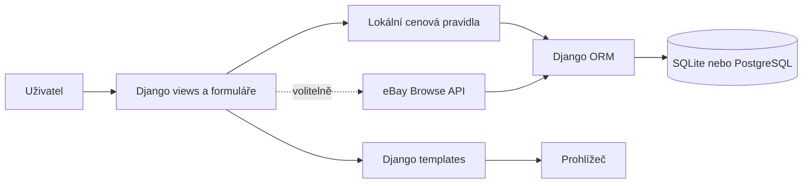

# ResaleAI

Webová aplikace v Django pro orientační ocenění zboží z druhé ruky, přípravu prodejních nabídek a evidenci jejich výsledků.

## Úvod a cíl projektu

Cílem projektu je usnadnit prodejci přípravu nabídky a přehled o nákladech i dosaženém zisku. Aplikace z údajů o předmětu vytvoří cenový odhad a návrh textu, který může prodejce dále upravit. Volitelně porovnává cenu s aktuálně vystavenými nabídkami na eBay; nejde o potvrzené prodejní ceny. Projekt je vytvořen jako maturitní práce.

## Použité technologie

- **Python 3.10+ a Django 5.2** – serverová logika, URL, formuláře, uživatelské účty, administrace a ORM.
- **SQLite** – výchozí lokální databáze; nastavení podporuje také PostgreSQL.
- **Django Templates, HTML a vlastní CSS** – vykreslování stránek a vzhled aplikace.
- **Bootstrap 5.3 a Bootstrap Icons** – responzivní rozvržení a ikony načítané z CDN.
- **Pillow** – zpracování nahraných fotografií.
- **Requests** – komunikace s eBay Browse API.
- **python-decouple** – konfigurace z proměnných prostředí a souboru `.env`.
- **django-storages** – volitelné S3 úložiště obrázků.
- **Django TestCase a GitHub Actions** – automatické testy a kontrola projektu při změnách.

Rozsahy verzí a další balíčky jsou uvedeny v [requirements.txt](requirements.txt). Některé závislosti (PostgreSQL a S3) jsou potřeba pouze při použití příslušné volitelné konfigurace.

## Jak to funguje

Veřejná část zobrazuje katalog produktů a trendy. Přihlášený prodejce zadá název, kategorii, stav, pořizovací cenu a náklady. Lokální pravidla připraví cenový odhad a návrh titulku a popisu. Pokud jsou nastaveny přihlašovací údaje eBay, aplikace může odhad porovnat s aktivními nabídkami eBay.de. Výsledek se uloží jako soukromá položka účtu, u které lze sledovat stav a po prodeji zapsat skutečné náklady.



Podrobnější popis včetně vztahů databázových modelů je v [docs/ARCHITEKTURA.md](docs/ARCHITEKTURA.md).

## Struktura repozitáře

```text
resale_ai/
├── manage.py                         # příkazová řádka Django
├── requirements.txt                  # Python závislosti
├── .env.example                      # vzor konfigurace bez tajných údajů
├── .gitignore                        # lokální prostředí, databáze a cache
├── README.md                         # úvod a návod ke spuštění
├── LICENSE                           # licence MIT
├── docs/                             # technická dokumentace
├── resale_ai/                        # nastavení, hlavní URL a WSGI
├── products/                         # modely, formuláře, views a aplikační logika
│   ├── migrations/                   # databázová schémata
│   ├── management/commands/           # příkaz seed_data pro ukázková data
│   └── tests.py                      # automatické testy aplikace
├── templates/                        # společné a stránkové Django šablony
├── static/css/                       # vlastní styly
└── .github/workflows/ci.yml           # kontroly v GitHub Actions
```

## Instalace a spuštění

Příkazy jsou pro Windows PowerShell a spouštějí se v kořenové složce projektu. Je potřeba Python 3.10 nebo novější.

1. Vytvoř a aktivuj virtuální prostředí:

   ```powershell
   py -m venv .venv
   .\.venv\Scripts\Activate.ps1
   ```

2. Nainstaluj závislosti:

   ```powershell
   python -m pip install --upgrade pip
   python -m pip install -r requirements.txt
   ```

3. Vytvoř databázové tabulky a naplň veřejný katalog ukázkovými daty:

   ```powershell
   python manage.py migrate
   python manage.py seed_data
   ```

   Příkaz `seed_data` přidává ukázkové produkty, trendy a recenze. Volba `python manage.py seed_data --flush` nejprve smaže stávající produkty, recenze a trendy, proto ji používej jen nad daty, která můžeš odstranit.

4. Pro správu katalogu vytvoř administrátorský účet (běžní prodejci se registrují v aplikaci):

   ```powershell
   python manage.py createsuperuser
   ```

5. Spusť vývojový server:

   ```powershell
   python manage.py runserver
   ```

   Otevři <http://127.0.0.1:8000/>. Administrace Django je na <http://127.0.0.1:8000/admin/>.

Pro lokální spuštění není soubor `.env` povinný. Výchozí konfigurace používá SQLite a lokální úložiště `media/`. Pro eBay data vytvoř lokální konfiguraci příkazem `Copy-Item .env.example .env` a doplň `EBAY_CLIENT_ID` a `EBAY_CLIENT_SECRET`; bez těchto údajů funguje cenový odhad z lokálních pravidel. `.env` neukládej do verzování. Výchozí tajný klíč je určen pouze pro místní vývoj, ne pro nasazení.

Za reverzní proxy nastav `TRUST_PROXY_SSL_HEADER=True` pouze tehdy, pokud proxy přepisuje příchozí `X-Forwarded-Proto` na důvěryhodnou hodnotu. Jinak ponech výchozí `False`.

V GitHubu nastav citlivé hodnoty jako **repository secrets** v `Settings → Secrets and variables → Actions` (názvy `EBAY_CLIENT_ID` a `EBAY_CLIENT_SECRET`). Nevkládej jejich hodnoty do README, zdrojových souborů ani `.env.example`. Repozitář neobsahuje nasazovací workflow; samotné uložení secrets proto aplikaci automaticky nenakonfiguruje.

## Ukázka použití

- **Domů, katalog a trendy** (`/`, `/products/`, `/trending/`): prohlížení veřejných produktů, hledání a filtrování katalogu.
- **Registrace a přihlášení** (`/register/`, `/login/`): vytvoření účtu prodejce.
- **Generátor** (`/generate-listing/`): zadání údajů o zboží a zobrazení odhadu, návrhu nabídky a orientačního porovnání cen.
- **Přehled a inventář** (`/dashboard/`, `/my-ai-listings/`): sledování připravených, vystavených a prodaných položek a výsledků.
- **Detail nabídky** (`/my-ai-listings/<id>/`): změna stavu, zadání skutečné prodejní ceny, dopravy a poplatku.
- **Správa katalogu** (`/admin/`): administrace dostupná účtu se správcovskými oprávněními.

## Možná budoucí vylepšení

- Doplnit další zdroje tržních dat a porovnávání podle přesnějších parametrů zboží.
- Přidat export inventáře a přehledů do CSV.
- Rozšířit testy o další scénáře práce s formuláři a externím API.
- Připravit nasazovací návod pro konkrétní hosting.

## Screenshoty

Zatím nejsou přiloženy. Před odevzdáním doplň vlastní snímky a odstraň z nich osobní údaje.

- Domovská stránka: `[doplnit screenshot]`
- Katalog a detail produktu: `[doplnit screenshot]`
- Přehled prodejce a generátor nabídky: `[doplnit screenshot]`

## Autor a škola

- Autor: Oliver Plaček
- Škola: SŠPU Opava
- Školní rok: 2026/2027

## Licence

Projekt je dostupný pod licencí MIT. Podrobnosti jsou v souboru [LICENSE](LICENSE).
