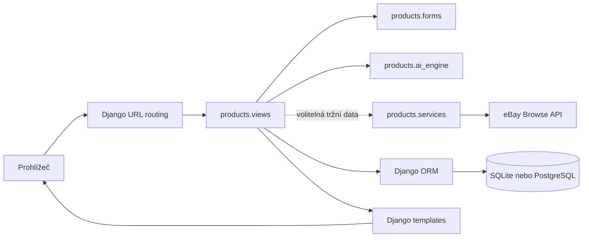
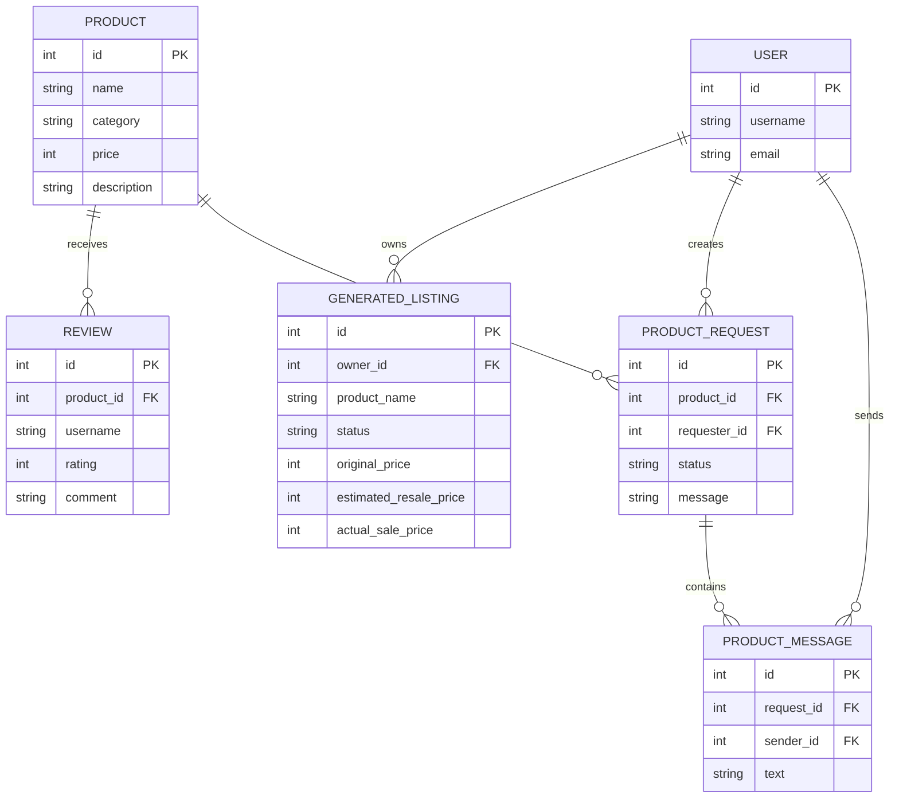

# Architektura ResaleAI

## Přehled

ResaleAI je server-rendered webová aplikace v Pythonu 3 a Django 5.2. Projekt tvoří jedna Django aplikace `products` a projektová konfigurace `resale_ai`. Databázový přístup zajišťuje Django ORM; lokální výchozí databází je SQLite, konfigurace podporuje také PostgreSQL. Uživatelské rozhraní skládají Django templates, Bootstrap načítaný z CDN a vlastní CSS.

Aplikace má dvě hlavní oblasti:

- Veřejný katalog s produkty, hodnoceními a předpřipravenými trendy. Katalogové produkty a trendy spravuje administrátor.
- Soukromý pracovní prostor prodejce: účet, generování návrhu nabídky, inventář a evidence skutečného výsledku prodeje.

## Vrstvy a odpovědnosti



- `resale_ai/settings.py` načítá nastavení z prostředí, definuje databázi, middleware, statické soubory a úložiště médií.
- `resale_ai/urls.py` zapojuje administraci a URL aplikace.
- `products/urls.py` mapuje adresy na pohledy.
- `products/views.py` řídí HTTP workflow a kontroluje přístup uživatelů.
- `products/forms.py` validuje data před uložením.
- `products/ai_engine.py` obsahuje lokální deterministické/heuristické výpočty a šablony textů. Nevolá jazykový model; bez eBay používá také náhodnou přirážku, proto může být odhad při opakování odlišný.
- `products/services.py` získává OAuth token a ceny aktivních nabídek přes eBay Browse API. Síťová volání mají časový limit a při nedostupnosti se pokračuje bez tržních dat.
- `products/models.py` definuje schéma a výpočty finančního výsledku.
- `templates/` a `static/` vykreslují uživatelské rozhraní.

## Datový model



`GeneratedListing` je oddělen od veřejného `Product`: každý záznam má vlastníka a pohledy jej filtrují podle přihlášeného uživatele. `ProductRequest` spojuje zájemce s katalogovou položkou a `ProductMessage` uchovává komunikaci k žádosti. Kategorie a stav jsou uložené jako textové hodnoty omezené volbami Django modelu, nikoli jako samostatné tabulky. `Trend` je samostatná sada katalogových dat bez vazby na uživatele.

## Bezpečnostní hranice

- Django zpracovává hesla přes svůj hashovací systém; registrační formulář používá nakonfigurované password validators.
- Vlastní nabídky se načítají podle vlastníka; komunikaci čte pouze správce nebo autor žádosti. Stav žádosti může měnit jen správce.
- Změnové formuláře používají CSRF tokeny; odhlášení, žádost o produkt a aktualizace eBay vyžadují POST.
- Tajné údaje se načítají z proměnných prostředí nebo lokálního `.env`. `.env` je ignorovaný Gitem; veřejný `.env.example` obsahuje jen prázdné hodnoty.
- Obrázek nahraný formulářem je omezen na 8 MB a validován jako obrazový soubor Django/Pillow.
- Produkční režim vyžaduje vlastní `SECRET_KEY`, `DEBUG=False`, bezpečné cookies, HTTPS a správné `ALLOWED_HOSTS`. `TRUST_PROXY_SSL_HEADER=True` nastav pouze tehdy, když důvěryhodná reverzní proxy přepisuje příchozí hlavičku `X-Forwarded-Proto`; výchozí hodnota je vypnutá.

## Databáze a výkon

Databázové změny jsou verzované v `products/migrations/`. ORM používá parametrizované dotazy. Katalog i inventář jsou stránkované; přehledy agregují část finančních výpočtů v databázi. Detail produktu vypočítá rozdělení recenzí jedním seskupeným dotazem. Při růstu dat je vhodné měřit reálné SQL dotazy a přidávat indexy podle profilování, nikoli odhadem.

Ukázková data vytváří příkaz `python manage.py seed_data`. Volba `--flush` maže katalogové produkty, recenze a trendy, proto není určena pro databázi s daty, která chceš zachovat.

## Omezení a provoz

- eBay Browse API vrací aktivní nabídkové ceny, ne uzavřené transakce. Odhady nejsou zárukou prodejní ceny.
- Platformní poplatky zadává uživatel; aplikace je sama nestahuje ani nepotvrzuje.
- Aplikace nezajišťuje platby, košík, dopravu, autentizaci vůči tržištím ani sporové řízení.
- GitHub Actions spouští `manage.py check`, kontrolu migrací a testy. Uložené GitHub Actions secrets se do běžící aplikace automaticky nepředávají; nasazovací workflow ani konkrétní produkční hosting nejsou součástí projektu.
- SQLite a lokální `media/` jsou výchozí pro vývoj. Pro veřejný provoz je třeba zvolit spravovanou databázi a úložiště, nastavit zálohy a ověřit obnovu.

## Ověření

```powershell
python manage.py check
python manage.py makemigrations --check --dry-run
python manage.py test
```
