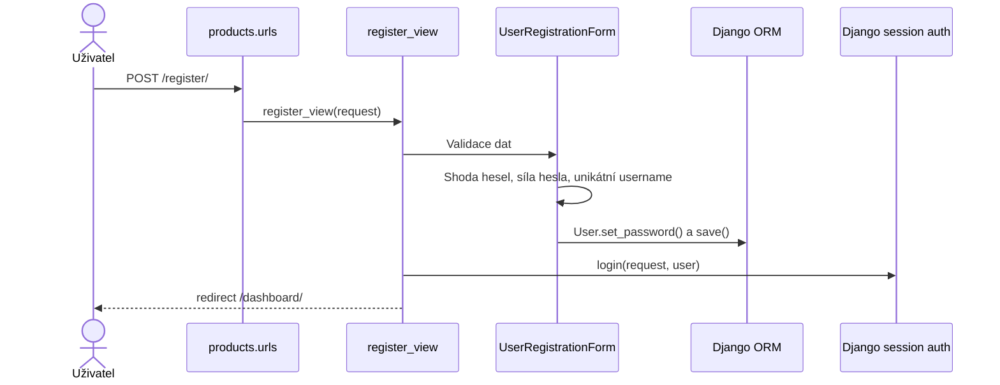
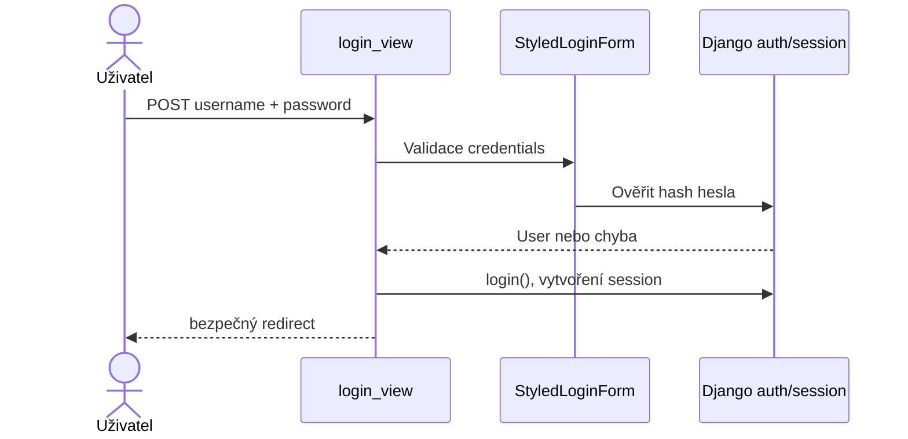
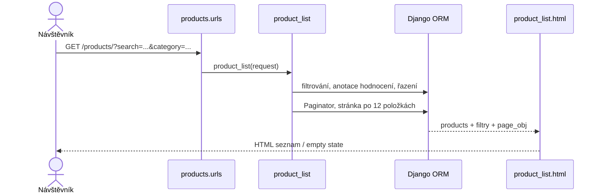
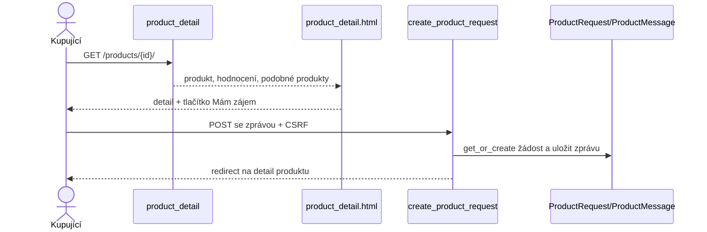
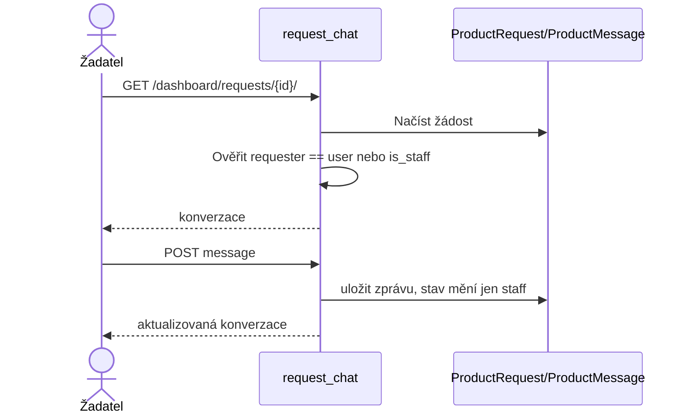
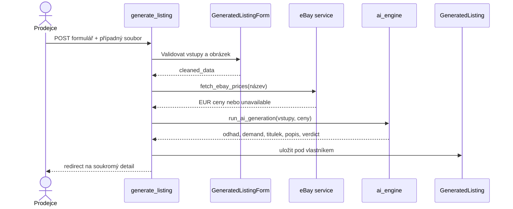
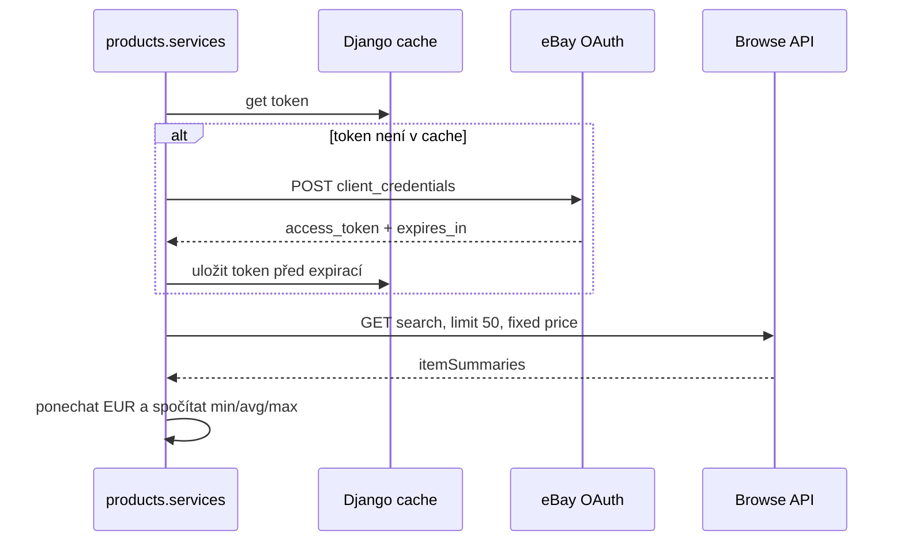
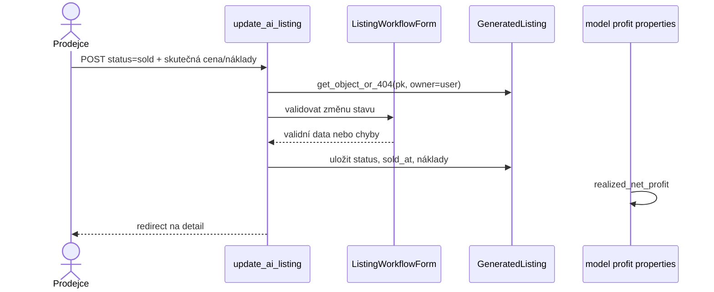
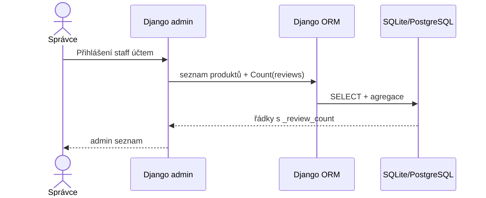

# A3 – Průvodce kódem pro obhajobu

Tento průvodce popisuje skutečné toky. Sekvence „objednávka“ a „platba“ nejsou nakresleny jako funkční části, protože v aplikaci neexistují.

## Mapa projektu

- `manage.py` – vstup pro příkazy Django.
- `resale_ai/settings.py` – konfigurace prostředí, middleware, databáze, auth, úložiště, logging.
- `resale_ai/urls.py` – admin, aplikační URL a vývojové servírování médií.
- `products/urls.py` – mapování cest na views.
- `products/models.py` – `Product`, `Review`, `Trend`, `ProductRequest`, `ProductMessage`, `GeneratedListing` a volby stavů/kategorií.
- `products/forms.py` – validace katalogu, registrace, uploadu a prodejního workflow.
- `products/views.py` – HTTP kontroléry a kontrola oprávnění.
- `products/ai_engine.py` – lokální cenové heuristiky a textové šablony.
- `products/services.py` – eBay OAuth a Browse API.
- `products/admin.py` – interní správa katalogu, recenzí, trendů a žádostí.
- `products/management/commands/seed_data.py` – demonstrační katalog.
- `products/migrations/` – verzované změny schématu.
- `templates/` – serverové HTML šablony; `static/css/custom.css` – styly.
- `products/tests.py` – unit a integrační testy.

## Toky

### 1. Registrace

`products/urls.py` → `register_view` → `UserRegistrationForm` → password validators → `set_password` → Django `User` → session login → přesměrování na dashboard.

### 2. Přihlášení a odhlášení

`login_view` použije Django `AuthenticationForm`; Django ověří hash hesla. Po loginu se bezpečně kontroluje `next`. Odhlášení přijímá pouze POST.

### 3. Katalog a vyhledávání

`product_list` čte query parametry `search`, `category`, `sort`, filtruje ORM queryset, řadí a použije `Paginator` po 12 položkách. Data jsou v `Product`, katalog ovládá admin.

Poznámka pro obhajobu: současná šablona kontroluje `product.review_count`, vlastnost, která dotazuje DB znovu. To je kandidát na další optimalizaci N+1.

### 4. Detail katalogové položky a žádost o produkt

Detail `product_detail` načte `Product`, recenze, seskupené počty hodnocení a podobné produkty. Přihlášený běžný uživatel odešle POST na `create_product_request`; vznikne `ProductRequest` a úvodní `ProductMessage`. Není to nákup ani objednávka.

### 5. Chat k žádosti

`request_chat` vyžaduje přihlášení; povolí správce nebo původního žadatele. Žadatel může posílat zprávy, ale stav mění jen správce. Tento chat se váže na katalogový `ProductRequest`, ne na veřejný prodejní listing.

### 6. Vytvoření soukromého prodejního konceptu

`generate_listing` validuje `GeneratedListingForm`, zkusí získat eBay data, zavolá `run_ai_generation`, uloží `GeneratedListing(owner=request.user, ...)` a přesměruje na detail. `ImageField` ukládá maximálně 8MB obrázek. Koncept zůstává soukromý.

### 7. eBay OAuth a cenové nabídky

`_get_ebay_access_token` nejprve zkusí Django cache; jinak použije client credentials. `fetch_ebay_prices` hledá maximálně 50 fixed-price položek, vybere EUR ceny, spočítá min/avg/max a zachytí síťové chyby s timeoutem. Výsledek tvoří nabídkové ceny, nikoli skutečné prodeje.

### 8. Označení konceptu jako prodaného

`ai_listing_detail` a `update_ai_listing` filtrují podle ID i vlastníka. `ListingWorkflowForm` vyžaduje skutečnou prodejní cenu při statusu `sold`. View nastaví `sold_at` a model vypočítá skutečný čistý zisk. Neprobíhá blokace zásoby ani platba.

### 9. Admin a demonstrační data

`ProductAdmin`, `TrendAdmin` a další registrace poskytují Django admin. V aktuálním pracovním stromu ProductAdmin annotuje `_review_count`, aby se vyhnul N+1 dotazu. `seed_data` přidá katalog, trendy a fiktivní recenze; lokální změna příkaz odmítá při `DEBUG=False`. Při `--flush` maže produkty, recenze a trendy, proto ho používej jen v oddělené demo databázi.

## Co aplikace nedělá

Neexistuje veřejná registrace inzerátů od uživatelů, checkout, objednávka, platební brána, doprava/štítky, escrow, spor, reklamace ani refundace. Není tedy možné implementačně ukazovat „dvojí nákup“, „refund“ nebo platbu. Vhodná obhajoba je vysvětlit jejich absence a navrhnout jejich samostatné modely/stavy.

## Slovník

| Pojem | Jednoduché vysvětlení | Použití v projektu |
|---|---|---|
| Django view | Funkce obsluhující HTTP cestu. | `products/views.py`. |
| Django ORM | Python API, které skládá parametrizované SQL dotazy. | Modely/querysety. |
| Form | Validace nedůvěryhodného vstupu z HTML formuláře. | `products/forms.py`. |
| Middleware | Kód, který zpracuje každý požadavek před/po view. | CSRF, session, auth. |
| Migrace | Verze změny databázového schématu. | `products/migrations/`. |
| Session autentizace | Po loginu server vystaví cookie s identifikátorem session; heslo se při požadavcích neposílá znovu. | Django auth. |
| Hash hesla | Jednosměrný odvozený zápis hesla, který se používá k ověření. | `User.set_password`. |
| Foreign key | Odkaz řádku na související řádek jiné tabulky. | vlastník nabídky, zpráva žádosti. |
| OAuth client credentials | Serverový způsob, jak služba získá přístupový token bez interakce uživatele. | eBay Browse API. |
| Cache | Dočasné úložiště výsledků pro omezení opakovaných výpočtů/volání. | eBay access token. |
| Annotate | Přidá databázový vypočtený sloupec do výsledků querysetu. | Počet recenzí v adminu. |
| `@login_required` | Dekorátor, který vyžaduje přihlášenou session. | Soukromé views. |
| IDOR | Přístup k cizímu záznamu pouhou změnou ID. | Brání mu filtr `owner=request.user`. |

## Místa, která je nutné umět vysvětlit

1. Proč `GeneratedListing` zůstává soukromý a liší se od katalogového `Product`.
2. Co je přesně vstupem `calculate_estimated_price`, jak funguje fallback a proč je náhodný.
3. Proč eBay ceny nejsou completed sales a jak se filtruje měna.
4. Rozdíl `net_profit` versus `realized_net_profit`.
5. Jak owner filtr brání IDOR a proč se vrací 404.
6. Jak Django formulář validuje upload a kde je limit 8 MB.
7. Jak `ProductRequest` a `ProductMessage` tvoří konverzaci.
8. Co dělá `Count`, `Cast`, `Coalesce`, `ExpressionWrapper` v dashboardu.
9. Proč demo seed nesmí být spuštěn v produkci.
10. Která část eBay, SMTP, DB a media může selhat a jak se to projeví uživateli.
